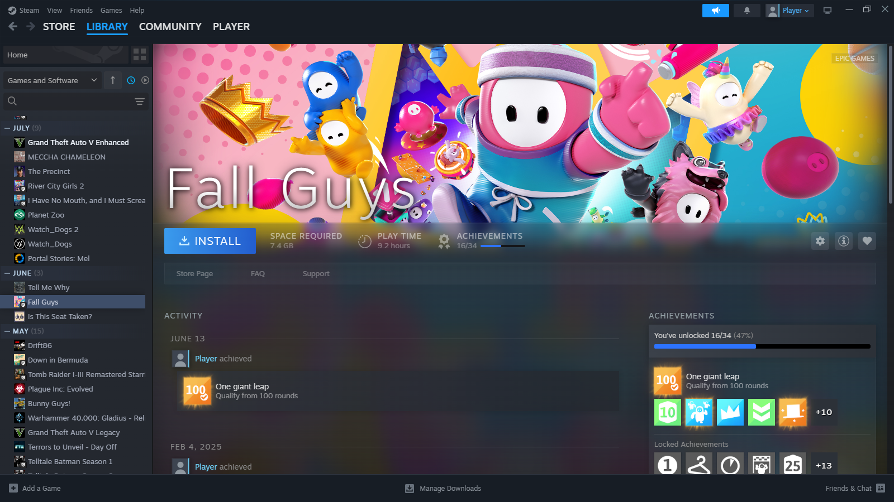
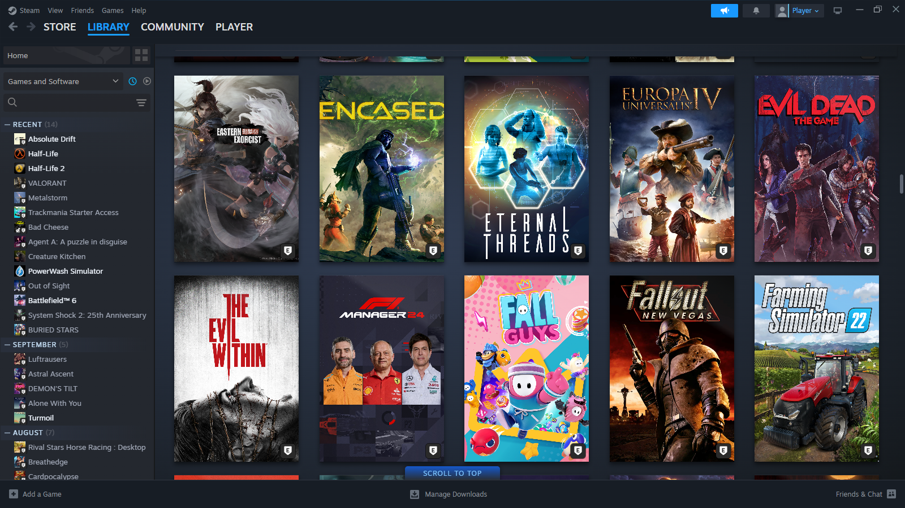
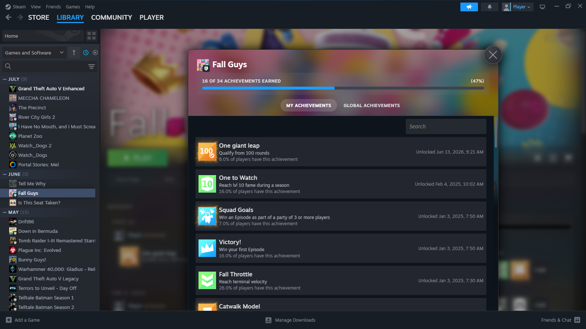
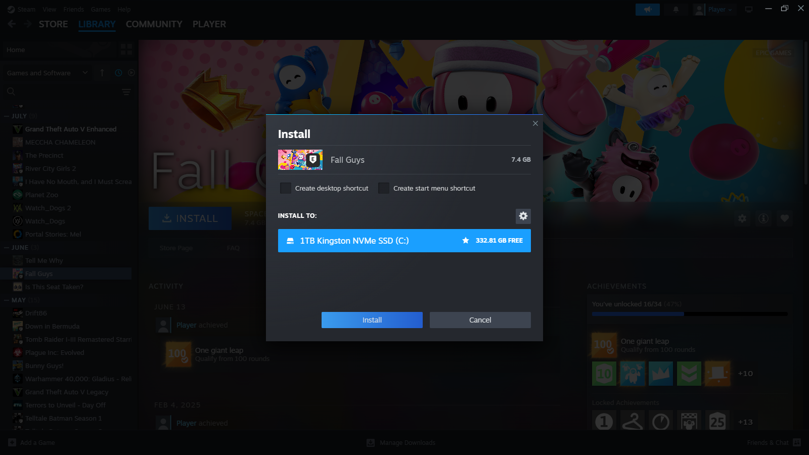
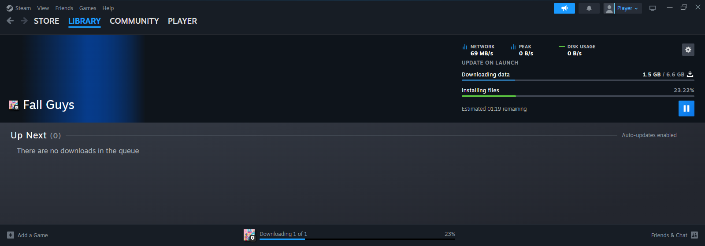

# Epic Games for Steam

**Your Epic library, inside Steam.** Install, launch, track playtime and sync saves without ever opening the Epic launcher.

 

  

> [!WARNING]
> **Work in progress.** Every patch reaches into Steam's own stores, and it hasn't seen many Steam builds or machines yet. Expect rough edges.

## ✨ Features

|                          |                                                                                       |
| :----------------------- | :------------------------------------------------------------------------------------ |
| 📚 **Library**           | Every Epic game you own, with full artwork and an Epic badge on the tile              |
| ⬇️ **Downloads**         | Install, update, pause and uninstall with progress on the tile and the Downloads page |
| ▶️ **Launch**            | Playtime reported to Epic, "Currently playing" and the Steam overlay                  |
| ☁️ **Cloud saves**       | Synced before launch and after exit, with Steam's Cloud Status and conflict dialogs   |
| 🏆 **Achievements**      | On the game page and Steam's achievements page                                        |
| 🧩 **DLC**               | Installs with its game, and managed from Properties > DLC                             |
| 🛠️ **Verify & repair**   | Fix corrupted or missing files from Properties > Installed Files                      |
| 🛒 **Store**             | An Epic Games Store submenu; anything you buy or claim lands in your library          |
| 🔗 **Existing installs** | Games from the Epic launcher show as installed, not as a second download              |

## 📸 Screenshots

<table>
  <tr>
    <td width="50%"></td>
    <td width="50%"></td>
  </tr>
  <tr>
    <td align="center">Your Epic games, right in the library</td>
    <td align="center">Epic achievements on Steam's own page</td>
  </tr>
  <tr>
    <td width="50%"></td>
    <td width="50%"></td>
  </tr>
  <tr>
    <td align="center">Steam's install dialog</td>
    <td align="center">Downloads with Steam's own progress</td>
  </tr>
</table>

## 🚀 Get started

You need **Steam** with [**Millennium**](https://steambrew.app/), on Windows or Linux. Nothing else: [Legendary](https://github.com/derrod/legendary) is downloaded for you on first run.

1. **Sign in.** In Steam, open **Store > Epic Games Store** and sign in to Epic.
2. **Open the panel.** Pick **Epic Games** from Millennium's plugin list.
3. **Add to Steam.** Press the button and let it run.

> [!TIP]
> The first sync takes a few minutes on a big library. After that, only changes are picked up.

## 💖 Support

If this saves you from opening the Epic launcher, consider [buying me a coffee on Ko-fi](https://ko-fi.com/X8X554X28) ☕

Not affiliated with Valve or Epic Games.

